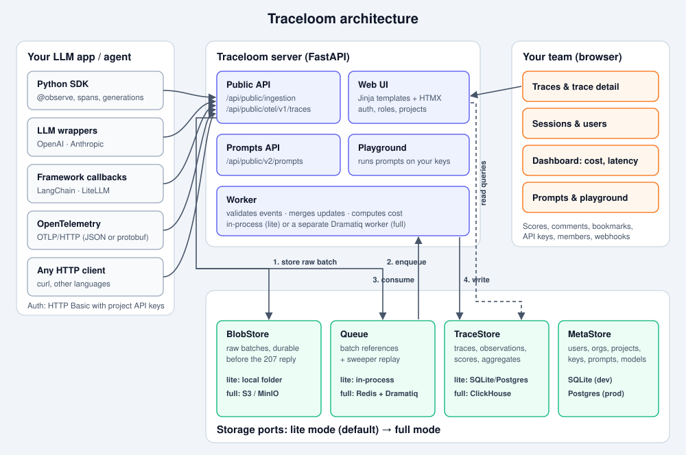

# Traceloom

**See what your AI app is doing.** Traceloom records every request your app sends to an LLM: the question, the answer, how long it took, how much it cost and what went wrong. You get one place to look when a user says "the bot gave me a weird answer".

It runs on your own server, so your prompts and your users' data never leave your machine.

<p align="center">
  
</p>

## What you can do with it

- **See every request.** The prompt, the reply, the model, tokens, time and cost, for each call your app makes.
- **Follow a whole conversation.** Group requests by user or chat session and replay what happened, step by step.
- **Find problems fast.** Errors and slow calls stand out. Search and filter to find the one request a user complained about.
- **Know what you spend.** Cost per request, per model, per user and per day.
- **Improve your prompts.** Keep versions of your prompts, try changes in a playground, and roll back if a change makes things worse.
- **Check quality.** Collect thumbs up or down from users, review answers with your team, or let another LLM grade them automatically.

## Get started in 3 steps

### 1. Start Traceloom

You need [Docker](https://docs.docker.com/get-docker/).

```bash
git clone https://github.com/kmugalkhod/traceloom.git
cd traceloom
export TRACELOOM_SERVER_SECRET=$(openssl rand -hex 32)
docker compose -f docker-compose.lite.yml up -d --build
```

Open **http://localhost:8000**. That's it: Traceloom is running.

<details>
<summary>No Docker? Run it with Python instead</summary>

You need Python 3.12 or newer.

```bash
git clone https://github.com/kmugalkhod/traceloom.git
cd traceloom
python3 -m venv .venv
.venv/bin/pip install -e . -e ./sdk/python
cp .env.example .env
echo "TRACELOOM_SERVER_SECRET=$(openssl rand -hex 32)" >> .env
.venv/bin/uvicorn traceloom.main:app --port 8000
```

</details>

### 2. Get your keys

Create a demo account with one command:

```bash
docker compose -f docker-compose.lite.yml exec web traceloom seed-demo
```

It prints a login (`demo@example.com` / `demo-password-123`) and two keys. Your app uses these keys to send its requests to Traceloom:

```text
public key:   tl-pk-demo-…
secret key:   tl-sk-demo-…
```

Prefer your own account? Go to http://localhost:8000/signup, create a project, then open **Settings → API keys**.

### 3. Connect your app

Install the Traceloom library in your app:

```bash
pip install "traceloom-sdk @ git+https://github.com/kmugalkhod/traceloom.git#subdirectory=sdk/python"
```

Tell it where Traceloom is and give it your keys:

```bash
export TRACELOOM_HOST=http://localhost:8000
export TRACELOOM_PUBLIC_KEY=tl-pk-...
export TRACELOOM_SECRET_KEY=tl-sk-...
```

Now add **one line** to your app. Here is a complete chatbot using OpenAI:

```python
from openai import OpenAI
from traceloom_sdk.openai import wrap

client = wrap(OpenAI())   # ← the only change: wrap your client

reply = client.chat.completions.create(
    model="gpt-4o-mini",
    messages=[{"role": "user", "content": "Write a haiku about debugging."}],
)
print(reply.choices[0].message.content)
```

Run it, then open **Traces** in Traceloom. Your request is there, with the prompt, the reply, tokens, time and cost.

Using Anthropic (Claude)? It works the same way:

```python
import anthropic
from traceloom_sdk.anthropic import wrap

client = wrap(anthropic.Anthropic())
client.messages.create(
    model="claude-sonnet-5-5",
    max_tokens=200,
    messages=[{"role": "user", "content": "Write a haiku about debugging."}],
)
```

> **No LLM key handy?** From the Traceloom folder, run `python examples/agent.py` (with the library installed and the three variables set). It uses a pretend model, so you can see what a trace looks like without spending anything.

## Make your traces more useful

These are optional. Add them when you need them.

### Group the steps of one task

If your app does several things to answer one question (look something up, then call the LLM), put `@observe()` on your functions. Each call becomes one trace with every step inside it.

```python
import traceloom_sdk
from traceloom_sdk import observe
from traceloom_sdk.openai import wrap
from openai import OpenAI

client = wrap(OpenAI())


@observe()
def find_docs(question):
    return ["Refunds are possible within 30 days."]


@observe(name="support-bot")
def answer(question, user_id):
    traceloom_sdk.update_current_trace(user_id=user_id, session_id="chat-42")
    docs = find_docs(question)
    reply = client.chat.completions.create(
        model="gpt-4o-mini",
        messages=[
            {"role": "system", "content": f"Answer using: {docs}"},
            {"role": "user", "content": question},
        ],
    )
    return reply.choices[0].message.content


print(answer("Can I get a refund?", user_id="ann"))
```

- `user_id` lets you see everything one person did (the **Users** page).
- `session_id` groups a whole conversation (the **Sessions** page).

### Collect feedback from users

Record a thumbs up or down, or a rating, against the request it was about:

```python
trace_id = traceloom_sdk.get_current_trace_id()   # inside your @observe function
...
traceloom_sdk.score("thumbs", True, trace_id=trace_id)
```

For a website, Traceloom also gives you a small script for thumbs buttons (**Settings → Evaluation**).

### Keep your prompts in Traceloom

Write and version prompts in the **Prompts** page, then load them in your app. Changing the wording no longer needs a new deploy, and each request is linked to the prompt version it used.

```python
prompt = traceloom_sdk.get_prompt("support", fallback="You are a friendly assistant helping {{name}}.")
messages = prompt.compile(name="Ann")   # fills in {{name}}
```

If Traceloom can't be reached, your app uses the fallback and keeps working.

### Check answer quality

- **Annotation queues:** your team reviews answers one by one and scores them.
- **LLM judges:** another model grades new answers automatically, for example "Is this answer correct?" You set a daily spending limit.
- **Datasets and experiments:** save real questions as a test set, then run a new prompt or model over them and compare the results side by side before you ship.

## Works with your tools

| You use | How to connect |
|---|---|
| OpenAI or Anthropic Python libraries | `wrap(client)`, shown above |
| LangChain | `from traceloom_sdk.langchain import CallbackHandler` |
| LiteLLM | `from traceloom_sdk.litellm import callback`, then `litellm.success_callback = [callback]` |
| Any language with OpenTelemetry | Point the exporter at `http://<your server>/api/public/otel/v1/traces` |
| Anything else | Send JSON to `POST /api/public/ingestion` |

Examples for each are in the [technical reference](docs/REFERENCE.md#all-the-ways-to-send-traces).

**It never slows your app down.** The library sends data in the background. If Traceloom is down, your app keeps running normally.

## Host it for your team

The steps above run Traceloom on your laptop. To share it with your team, run the same thing on a server.

**Pick a size**

| | Small (start here) | Large |
|---|---|---|
| Good for | Getting started, one team, moderate traffic | Heavy production traffic, many teams |
| Runs | One container, data in SQLite | Web, worker, Postgres, Redis, ClickHouse, MinIO |
| Start with | `docker compose -f docker-compose.lite.yml up -d` | `docker compose up -d` |
| Memory | under 1 GB | about 5 GB |

**Before you let others in, set these.** Put them in a `.env` file in the Traceloom folder (Docker Compose reads it automatically):

```bash
TRACELOOM_ENV=production
TRACELOOM_SERVER_SECRET=<a long random string, keep it safe>
TRACELOOM_ENCRYPTION_KEY=<python -c "from cryptography.fernet import Fernet; print(Fernet.generate_key().decode())">
TRACELOOM_BASE_URL=https://traceloom.your-company.com
TRACELOOM_SIGNUP_ENABLED=false     # invite people instead
```

For the large setup, also set `POSTGRES_PASSWORD`, `MINIO_ROOT_PASSWORD` and `CLICKHOUSE_PASSWORD`.

**A short checklist**

- **Use HTTPS.** Put Traceloom behind a web server such as Caddy or Nginx.
- **Keep the secret.** If `TRACELOOM_SERVER_SECRET` changes, logins and API keys stop working.
- **Back up your data.** In the small setup everything is in the `traceloom-data` Docker volume.
- **Invite your team** from **Settings → Members & invites**. Roles: Owner, Admin, Member and Viewer (read-only).
- **Update** with `git pull`, then the same `docker compose … up -d --build` command.

Then point your apps at your server: `TRACELOOM_HOST=https://traceloom.your-company.com`.

## Common questions

**My requests don't show up.**
Check that `TRACELOOM_HOST` and the keys are set in the same place your app runs. For short scripts, add `traceloom_sdk.flush()` at the end so the last requests are sent before the script exits. In the app, check the time range at the top of the page.

**I get "Invalid API key".**
The keys were created with a different `TRACELOOM_SERVER_SECRET` than the one the server uses now. Set one fixed secret, restart, and create the keys again.

**I'm logged out every time Traceloom restarts.**
Same cause: set a fixed `TRACELOOM_SERVER_SECRET`.

**Does my data go anywhere else?**
No. Everything stays on the server you run. Traceloom only calls an LLM provider when you use the playground or LLM judges, with keys you add yourself.

**How do I turn tracing off?**
Set `TRACELOOM_ENABLED=false` in your app. To keep only some requests, set `TRACELOOM_SAMPLE_RATE=0.1` (10%).

## Learn more

- [Technical reference](docs/REFERENCE.md): every install option, SDK function, setting and API
- [Architecture](ARCHITECTURE.md): how Traceloom is built
- [Examples](examples/): a demo agent and a prompt-managed app
- Running the tests: `.venv/bin/pytest -q` and `.venv/bin/ruff check .`
