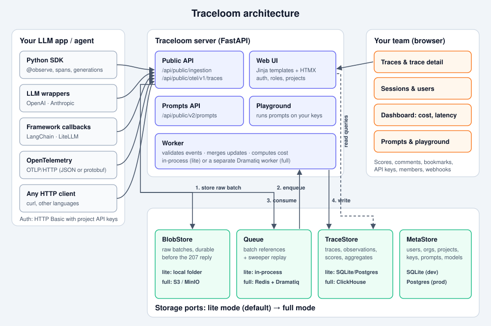
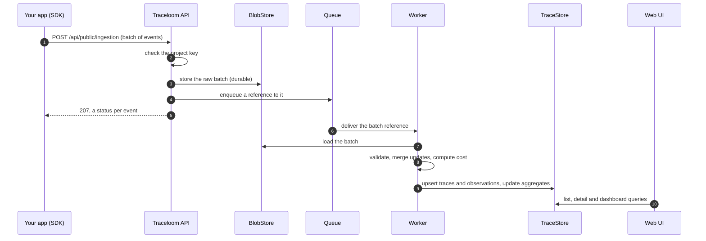

# Traceloom

**Traceloom is a self-hosted platform for LLM engineering.** Send traces from your LLM apps and agents, then use the web app to debug every step, track cost and latency, manage versioned prompts and try them in a playground. Your data stays on your own server.

<p align="center">
  
</p>

- [What you get](#what-you-get)
- [Install](#install)
- [Sign in and get API keys](#sign-in-and-get-api-keys)
- [Send your first trace in two minutes](#send-your-first-trace-in-two-minutes)
- [All the ways to send traces](#all-the-ways-to-send-traces)
- [Using the app](#using-the-app)
- [Prompts and playground](#prompts-and-playground)
- [How it works](#how-it-works)
- [Configuration](#configuration)
- [Troubleshooting](#troubleshooting)
- [Development](#development)

## What you get

| Area | What it does |
|---|---|
| **Tracing** | Nested traces of spans, generations (LLM calls), tool calls and events, with input, output, model, token usage, latency and errors. |
| **Trace explorer** | Searchable, filterable traces list; trace detail with a span tree and an input/output viewer; sessions and users views. |
| **Cost and dashboards** | Cost is computed from model prices you can edit. The dashboard shows cost, latency, volume, a breakdown by model and the top users. |
| **Prompt management** | Versioned prompts with labels (such as `production`), fetched from your app through the SDK with caching and a fallback. |
| **Playground** | Runs a prompt against your own provider keys, or reopens any LLM call from a trace to try it again. |
| **Collaboration** | Scores, comments, bookmarks, shareable trace links, organisations, projects, roles and invites. |
| **Integrations** | Python SDK, OpenAI and Anthropic wrappers, LangChain, LiteLLM, OpenTelemetry (OTLP/HTTP) and a plain HTTP API. |
| **Two modes** | **Lite** (default): one process with SQLite or Postgres. **Full**: Postgres, Redis, ClickHouse and MinIO for high volume. |

## Install

Choose one of the three options. Lite mode is the quickest way to start.

### Option A: run locally with Python (lite mode)

You need **Python 3.12+**.

```bash
git clone https://github.com/kmugalkhod/traceloom.git
cd traceloom

python3 -m venv .venv
.venv/bin/pip install -e '.[dev]' -e ./sdk/python

cp .env.example .env
# Set a fixed server secret, so API keys and logins survive restarts:
echo "TRACELOOM_SERVER_SECRET=$(openssl rand -hex 32)" >> .env

.venv/bin/uvicorn traceloom.main:app --port 8000
```

Check that it is up:

```bash
curl http://localhost:8000/api/public/health
```

Then open **http://localhost:8000**. Data is stored in `./data/` (a SQLite database and a folder of raw batches).

### Option B: Docker, lite mode

```bash
docker compose -f docker-compose.lite.yml up --build
```

This runs the web server only, with SQLite and the blob folder in a Docker volume, on port 8000.

### Option C: Docker, full mode (high volume)

Full mode runs the web server, a worker, Postgres, Redis, ClickHouse and MinIO. Memory limits add up to about 4.8 GB.

```bash
export TRACELOOM_SERVER_SECRET=$(openssl rand -hex 32)   # keep it: API key hashes depend on it
docker compose up --build
docker compose exec web traceloom seed-demo
```

- `web` runs `traceloom migrate`, then serves on port 8000. It accepts events, stores each batch in MinIO and puts it on the Redis queue.
- `worker` (`traceloom worker`) reads the queue, writes to ClickHouse and runs the sweeper, which replays batches that were stored but never processed.
- Before exposing it, set `TRACELOOM_ENV=production`, `POSTGRES_PASSWORD`, `MINIO_ROOT_PASSWORD` and `CLICKHOUSE_PASSWORD`.

## Sign in and get API keys

Every trace belongs to a **project**, and an app sends traces with that project's **API key pair**: a public key `tl-pk-…` and a secret key `tl-sk-…`.

**Fastest: the demo account.** This creates a demo login, an organisation, a project and a key pair, and prints them. It is safe to run again.

```bash
.venv/bin/traceloom seed-demo        # Docker: docker compose exec web traceloom seed-demo
```

```text
email:        demo@example.com
password:     demo-password-123
project id:   14c45dbe…
public key:   tl-pk-demo-…
secret key:   tl-sk-demo-…
```

> Run `seed-demo` with the same `TRACELOOM_SERVER_SECRET` as the server, for example from the same `.env`. Otherwise the server rejects the keys with `Invalid API key`.

**Your own account:**

1. Open http://localhost:8000/signup and create an account.
2. Create an organisation and a project.
3. Go to **Settings → API keys**, create a key pair and copy the secret key. It is shown only once.

## Send your first trace in two minutes

Set the keys once in your shell:

```bash
export TRACELOOM_HOST=http://localhost:8000
export TRACELOOM_PUBLIC_KEY=tl-pk-...
export TRACELOOM_SECRET_KEY=tl-sk-...
```

**1. Run the demo agent.** It needs no LLM API key, because it uses a built-in fake model.

```bash
.venv/bin/python examples/agent.py
```

Each run creates one trace: an agent span, a step span per turn, LLM generations with model names and token usage, tool calls, and one failing tool call so you can see how errors look.

**2. Or trace your own code.** Install the SDK in your app's environment with `pip install -e /path/to/traceloom/sdk/python`, then:

```python
import traceloom_sdk
from traceloom_sdk import observe


@observe()                                  # a span named "retrieve"
def retrieve(question: str) -> list[str]:
    return ["Traceloom stores traces, spans and generations."]


@observe(name="support-bot")                # the outermost call becomes the trace
def answer(question: str) -> str:
    docs = retrieve(question)
    traceloom_sdk.update_current_trace(user_id="user-42", session_id="chat-1", tags=["demo"])

    with traceloom_sdk.start_generation(
        "llm-call", model="claude-sonnet-5-5", input=[{"role": "user", "content": question}]
    ) as gen:
        reply = f"Answer based on {len(docs)} doc(s)."   # call your model here
        gen.update(output=reply, usage_details={"input": 25, "output": 8})
    return reply


answer("What does Traceloom store?")
traceloom_sdk.get_client().flush()          # short scripts: send buffered events before exiting
```

**3. Open the trace.** Go to **Traces** in the web app (`/project/<project id>/traces`). The trace appears within a few seconds. Click it to see the span tree, inputs, outputs, tokens and cost.

**Want lots of data at once?** The load-test script sends synthetic traces:

```bash
.venv/bin/python scripts/loadtest.py --host $TRACELOOM_HOST --traces 200
```

## All the ways to send traces

All of them authenticate with the project key pair over HTTP Basic auth.

### Python SDK

Configure it with environment variables or in code:

```python
from traceloom_sdk import Traceloom, set_default_client

set_default_client(Traceloom(
    host="http://localhost:8000",
    public_key="tl-pk-...",
    secret_key="tl-sk-...",
    environment="production",    # shows up as the trace environment
    release="v1.4.0",
))
```

| Building block | Use it for |
|---|---|
| `@observe()` / `@observe(name=..., as_type="generation")` | Trace a function (sync, async or generator). Captures arguments and the return value. |
| `start_span(name, ...)` / `start_generation(name, model=..., ...)` | Context managers for manual spans and LLM calls. Call `.update(output=..., usage_details=...)` on them. |
| `event(name, ...)` | A point-in-time event. |
| `update_current_trace(user_id=, session_id=, tags=, metadata=)` | Attach a user, a session, tags or metadata to the current trace. |
| `score(name, value, trace_id=..., comment=...)` | Record a quality score, such as user feedback. |
| `get_client().flush()` | Send buffered events now. Do this at the end of scripts and serverless handlers. |

The SDK batches events in the background, so it never blocks your app. It retries on failure, and if the server is unreachable your app keeps running. Variables: `TRACELOOM_HOST`, `TRACELOOM_PUBLIC_KEY`, `TRACELOOM_SECRET_KEY`, `TRACELOOM_ENABLED`, `TRACELOOM_SAMPLE_RATE`, `TRACELOOM_FLUSH_AT` (default 50), `TRACELOOM_FLUSH_INTERVAL`, `TRACELOOM_ENVIRONMENT`, `TRACELOOM_RELEASE`.

### OpenAI and Anthropic wrappers

Wrap the client once, and every call is recorded as a generation, with model, messages, usage and streaming.

```python
from openai import OpenAI
from traceloom_sdk.openai import wrap

client = wrap(OpenAI())
client.chat.completions.create(model="gpt-4o-mini", messages=[{"role": "user", "content": "Hi"}])
```

```python
import anthropic
from traceloom_sdk.anthropic import wrap

client = wrap(anthropic.Anthropic())
client.messages.create(model="claude-sonnet-5-5", max_tokens=200,
                       messages=[{"role": "user", "content": "Hi"}])
```

### LangChain

```python
from traceloom_sdk.langchain import CallbackHandler

handler = CallbackHandler(user_id="user-42", session_id="chat-1")
chain.invoke({"question": "..."}, config={"callbacks": [handler]})
```

### LiteLLM

```python
import litellm
from traceloom_sdk.litellm import callback

litellm.success_callback = [callback]
litellm.failure_callback = [callback]
```

### OpenTelemetry (any language)

Point an OTLP/HTTP trace exporter (JSON or protobuf) at Traceloom:

```bash
export OTEL_EXPORTER_OTLP_TRACES_ENDPOINT=http://localhost:8000/api/public/otel/v1/traces
export OTEL_EXPORTER_OTLP_TRACES_HEADERS="Authorization=Basic $(printf '%s' "$TRACELOOM_PUBLIC_KEY:$TRACELOOM_SECRET_KEY" | base64)"
```

### Plain HTTP (curl or any language)

Send a batch of events to `POST /api/public/ingestion`. The reply is `207` with a status for each event.

```bash
NOW=$(date -u +%Y-%m-%dT%H:%M:%S.000Z)
curl -u "$TRACELOOM_PUBLIC_KEY:$TRACELOOM_SECRET_KEY" \
  -H 'Content-Type: application/json' \
  http://localhost:8000/api/public/ingestion -d '{
  "batch": [
    {"id": "evt-1", "type": "trace-create", "timestamp": "'$NOW'",
     "body": {"id": "trace-1", "name": "hello-traceloom", "userId": "user-1",
              "input": {"question": "What is Traceloom?"},
              "output": "A self-hosted LLM tracing platform.", "tags": ["curl"]}},
    {"id": "evt-2", "type": "generation-create", "timestamp": "'$NOW'",
     "body": {"id": "gen-1", "traceId": "trace-1", "name": "answer",
              "model": "claude-sonnet-5-5", "startTime": "'$NOW'", "endTime": "'$NOW'",
              "input": [{"role": "user", "content": "What is Traceloom?"}],
              "output": "A self-hosted LLM tracing platform.",
              "usageDetails": {"input": 12, "output": 9}}}
  ]}'
```

```json
{"successes":[{"id":"evt-1","status":201},{"id":"evt-2","status":201}],"errors":[]}
```

Event types: `trace-create`, `span-create`, `span-update`, `generation-create`, `generation-update`, `observation-create`, `observation-update`, `event-create` and `score-create`. Sending the same event `id` again is safe, because processing is idempotent. A batch can hold up to 1,000 events or 5 MB.

## Using the app

| Page | What you can do |
|---|---|
| **Dashboard** | Cost, latency percentiles (p50, p95), trace and token volume over time, a breakdown by model and the top users. Filter by environment and time range. |
| **Traces** | Search and filter by name, user, tags, status and time. Choose columns, bookmark traces and delete matching traces. |
| **Trace detail** | A full-height workspace: the span tree on the left, input and output for the selected step on the right, plus tags, scores, comments and a share link. Open any LLM call in the playground. |
| **Sessions / Users** | Group traces by `session_id` (a whole conversation) or by `user_id`. |
| **Prompts** | Create versioned prompts, move labels, compare versions and see the metrics of each version. |
| **Playground** | Run and compare prompts against your own LLM connections. |
| **Settings** | API keys, members and roles, LLM connections, model prices, webhooks and the audit log. |

Roles are **Owner**, **Admin**, **Member** and **Viewer**. Viewers can read everything but cannot change anything.

## Prompts and playground

Manage prompts under **Prompts**. Each save creates an immutable version, and labels point at the version an app should get. `production` is protected, so only Admins can move it. Content can include other prompts with `@@@prompt:<name>|label=<label>@@@`.

The **Playground** runs a prompt against your own provider keys, which you add under **Settings → LLM connections**. First set `TRACELOOM_ENCRYPTION_KEY` to a Fernet key, so those keys are stored encrypted and survive restarts:

```bash
python -c "from cryptography.fernet import Fernet; print(Fernet.generate_key().decode())"
```

Fetch a prompt from your app and link it to the LLM call:

```python
import traceloom_sdk

prompt = traceloom_sdk.get_prompt("support", fallback="You help {{name}}.")  # the production label
messages = prompt.compile(name="Ann")  # a str for text prompts, a list of messages for chat

with traceloom_sdk.start_generation(
    "answer", model="claude-sonnet-5-5", input=messages, prompt=prompt
):  # links the generation to that prompt version
    ...
```

`get_prompt` caches for `TRACELOOM_PROMPT_CACHE_TTL` seconds (default 60; `0` disables it). It serves the old version while it refreshes in the background, and uses the fallback when the server is unreachable (a fallback prompt is not linked). It raises `PromptNotFound` only when there is no cached value and no fallback. With the OpenAI and Anthropic wrappers, pass `traceloom_prompt=prompt` to a call to link it. See `examples/prompt_app.py` and the public API under `/api/public/v2/prompts`.

## How it works



- **Ingestion never blocks.** The request path does one blob write and one enqueue, with no database writes for trace data.
- **Accepted events are never lost.** The batch is stored before the `207` reply. If the worker or the queue is down, a sweeper replays stored batches later, and replay is idempotent.
- **Fast reads.** Latency, tokens, cost and error level are stored on each trace row at ingest, so the traces list never has to join observations.
- **Lite vs full** is a single switch (`TRACELOOM_MODE`). The same code talks to storage through ports:

| Port | Lite (default) | Full |
|---|---|---|
| TraceStore | SQLite or Postgres tables | ClickHouse |
| BlobStore | local folder | S3 / MinIO |
| Queue | in-process | Redis + Dramatiq worker |
| MetaStore | SQLite | Postgres |

More detail is in [`ARCHITECTURE.md`](ARCHITECTURE.md) and the decision records in [`docs/adr/`](docs/adr/).

## Configuration

All settings are environment variables, documented in `.env.example`. The most important ones:

| Variable | Default | Purpose |
|---|---|---|
| `TRACELOOM_SERVER_SECRET` | random per process in dev | Signs sessions and hashes API keys. **Set a fixed value.** It is required outside dev. |
| `TRACELOOM_ENCRYPTION_KEY` | random per process in dev | Fernet key that encrypts stored LLM keys and webhook secrets. |
| `TRACELOOM_ENV` | `dev` | `dev`, `test` or `production`. |
| `TRACELOOM_MODE` | `lite` | `lite` or `full`. |
| `DATABASE_URL` | `sqlite:///./data/traceloom.db` | Meta database (and the trace store in lite mode). Use Postgres in production. |
| `TRACELOOM_BASE_URL` | `http://localhost:8000` | Public URL, used in links and emails. |
| `TRACELOOM_BLOB_DIR` | `./data/blobs` | Raw batch folder in lite mode. |
| `TRACELOOM_SIGNUP_ENABLED` | `true` | Allow self sign-up. |
| `TRACELOOM_RATE_INGEST` | `600/minute` | Ingestion rate limit per key. |
| `REDIS_URL`, `S3_*`, `CLICKHOUSE_*` | | Full mode services. |
| `SMTP_*` | | Email for invites and password resets. |

## Troubleshooting

| Symptom | Fix |
|---|---|
| `401 Invalid API key` | The secret key is wrong, or the server and `traceloom seed-demo` used different `TRACELOOM_SERVER_SECRET` values. Set one fixed secret in `.env`, restart the server and re-run `seed-demo`. |
| Logged out after every restart | Same cause: without `TRACELOOM_SERVER_SECRET`, each start picks a new random secret. |
| A script's traces never appear | Call `traceloom_sdk.get_client().flush()` before the script exits. Check that `TRACELOOM_HOST` points at the server. |
| Warning: `TRACELOOM_ENCRYPTION_KEY is not set` | Set a Fernet key (see [Prompts and playground](#prompts-and-playground)), or LLM connections are lost on restart. |
| Traces are stored but not in the list | Check the time range and environment filters at the top of the page. |

## Development

```bash
.venv/bin/pytest -q          # tests (lite mode)
.venv/bin/ruff check .       # lint
```

Integration tests for the full-mode adapters need the services: `docker compose up -d minio redis clickhouse`, then `TRACELOOM_IT=1 .venv/bin/pytest -m it`.

```text
traceloom/        web + API server, worker, storage adapters
sdk/python/       Python SDK (traceloom-sdk)
examples/         demo agent and prompt app
scripts/          load test
deploy/           ClickHouse and other deployment config
docs/adr/         architecture decision records
sdlc/changes/     change history (intent → spec → plan → review)
```
