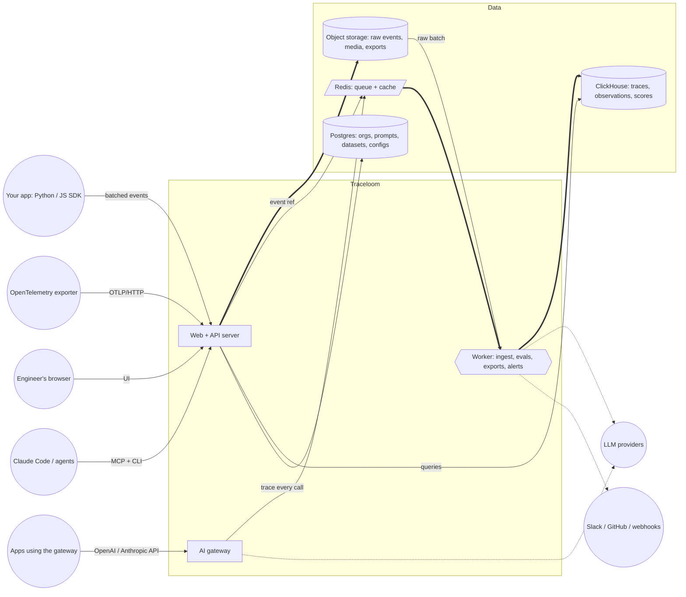

# Traceloom — an open LLM-engineering platform (Langfuse-style)

> How to use this file with the sdlc kit
> - This is too big for one change. Build it as **6 changes, in order**, one `/sdlc:loop` each.
> - The kit's architect step runs first on Phase 1. It should confirm or change the **Recommended architecture**
>   below and record each choice as an ADR. A human approves it before anything is planned.
>   The **Product** section is shared; paste it plus **one phase** each time.
> - Phase 1 prompt: everything from "Product" to the end of "Phase 1".
> - Later phases: say "Traceloom already exists in this repo (see README and sdlc/changes). Next change:" and paste that phase.
> - Team run per phase: `/sdlc:team <change> --qa 2`.

---

## Product

Build **Traceloom**: a self-hosted web app where engineers send the traces of their LLM apps and agents, then debug, measure cost, manage prompts and evaluate quality. Think of Langfuse, but it is an original product with its own name, UI and design. Do not copy Langfuse code, text, logos or styling.

**Users**
- **AI engineers** debugging why an agent run went wrong.
- **Team leads** watching cost, latency and quality per model, user and release.
- **Reviewers** labelling outputs by hand.

**Core ideas (data model)**
- **Organization → Project.** All data belongs to one project. A user can belong to many organizations, with one role per organization.
- **Trace:** one end-to-end request or agent run.
  - Fields: `id` (client-supplied or generated), `name`, `timestamp`, `input`, `output`, `user_id`, `session_id`, `tags[]`, `metadata` (JSON), `release`, `version`, `environment` (default `default`), `public` (shareable link on/off), `bookmarked`.
- **Observation:** one step inside a trace, nested by `parent_observation_id`.
  - Types: `span`, `generation`, `event`, `agent`, `tool`, `chain`, `retriever`, `embedding`, `evaluator`, `guardrail`.
  - Fields: `start_time`, `end_time`, `completion_start_time` (time to first token), `input`, `output`, `metadata`, `level` (DEBUG / DEFAULT / WARNING / ERROR), `status_message`, `version`, `environment`.
  - Generation-only fields: `model`, `model_parameters`, `usage_details` (input / output / cached / reasoning / any key → count), `cost_details` (same keys → USD), `prompt_name` + `prompt_version` link.
- **Session:** traces sharing a `session_id`, such as a chat conversation or a multi-day agent job.
- **User:** traces sharing a `user_id`.
- **Score:** a judgement attached to a trace, an observation, a session or a dataset run.
  - Fields: `name`, `value`, `data_type` (NUMERIC / BOOLEAN / CATEGORICAL), `string_value`, `comment`, `source` (API / ANNOTATION / EVAL / USER_FEEDBACK), `config_id`, `author`.
- **Model definition:** a model-name regex, a tokenizer, and prices per usage key. Optional price tiers apply above a prompt-size threshold. Definitions can be per project or global.
- **Prompt:** `name` and `version` (auto-incrementing), type text or chat, `labels[]` (`production`, `latest`, custom), `tags`, `config` (JSON), `commit_message`, and `{{variables}}`.
- **Dataset → Dataset item → Dataset run → Run item.** A run item links a dataset item to the trace or observation that produced it.

**Non-negotiables**
- **Nothing hardcoded.** Ports, DB URL, secrets, retention, model prices, LLM provider keys and SMTP all come from env or the settings UI. Ship a `.env.example`.
- **Speed and limits.**
  - Ingestion must never block the caller. Accept, queue, return `207` with a per-event status, then process async.
  - Must stay fast with 1M observations: indexed list queries, cursor pagination, no N+1 queries.
- **Security.**
  - Every API and page is project-scoped and permission-checked.
  - API keys are stored hashed. Inputs and outputs render as escaped text, JSON or Markdown, never raw HTML.
  - CSRF protection on forms; rate limits on auth and ingestion.
- **Targets the architecture must meet** (the architect proves each one in ARCHITECTURE.md):
  - Ingestion: 1,000 events/s sustained on one machine; accepted events are never lost if the worker or a database
    is down.
  - Queries: trace list page < 1 s and dashboards < 2 s at 10M observations; trace detail < 500 ms.
  - Volume: grow to 100M+ observations by adding storage, not by rewriting.
  - Laptop: the whole stack runs with Docker Compose in under 6 GB RAM, and a **lite mode** runs without ClickHouse
    or S3 for development and small teams.
- **Tests.** Every feature gets API tests and at least one real-browser test of its main journey. `pytest` must pass.
- **Design.** A dense, keyboard-friendly developer tool. Light and dark themes. Usable at 1280px, readable at 390px.

---

## Recommended architecture (the architect confirms or changes it, with ADRs)

This is the proven shape for LLM tracing at scale; Langfuse arrived at the same design. Diagram:
`traceloom-architecture.png`, editable as `traceloom-architecture.drawio`.

**Components**
| Component | Job | Technology |
|---|---|---|
| Web + API server | UI pages, public API, ingestion endpoints, OTLP endpoint, MCP server | Python FastAPI; server-rendered pages + HTMX; a small chart library |
| Worker | Turns raw event batches into rows; runs LLM and code evaluators, exports, retention, alerts | Python worker on Redis (RQ or Dramatiq); code evaluators run in a sandboxed subprocess with time and memory limits |
| AI gateway (Phase 5) | OpenAI/Anthropic-compatible proxy; traces every call; keys and budgets | Separate process from the web server so gateway load never slows the UI |
| Object storage | Raw ingested batches (durable buffer, replay), media (images/audio/files), exports | S3-compatible: MinIO locally, S3/GCS in the cloud |
| Redis | Job queue, rate limits, API-key and prompt cache | Redis 7 (or Valkey) |
| Postgres | Transactional data: users, orgs, projects, keys, prompts, skills, datasets, score configs, evaluators, dashboards, audit log | Postgres 16, SQLAlchemy + Alembic |
| ClickHouse | High-volume analytical data: traces, observations, scores | ClickHouse; `ReplacingMergeTree` by id and event time, so duplicate and out-of-order events merge |

**Key flows**
1. **Ingest:**
   - The SDK sends a batch.
   - The web server checks the key (Redis cache), writes the raw batch to object storage and puts a reference on
     the queue, then returns `207` at once.
   - The worker reads the batch, merges creates and updates by id, computes cost, and writes to ClickHouse.
   - Duplicates are harmless.
2. **Read:** UI and API queries go to ClickHouse for traces, observations and scores, and to Postgres for
   everything else. Cursor pagination, always filtered by project and time range.
3. **Prompt fetch:** the SDK calls `get_prompt`; the result is served from the Redis cache, falling back to
   Postgres.
4. **Evaluate:** a new trace that matches a judge rule gets a sampled job. The worker calls the LLM, or runs the
   code evaluator in its sandbox, and writes a score.

**Lite mode** (laptops, small teams): one setting switches storage to Postgres-only (traces in partitioned
tables), in-process queue, local folder instead of S3. The same code goes through a storage interface (the
`TraceStore` and `BlobStore` ports), so moving to the full stack is a config change.

**ADRs the architect should write (at least):**
- ClickHouse vs Postgres for trace data
- S3-first ingestion vs direct writes
- Redis queue library
- the lite-mode storage interface
- the code-evaluator sandbox
- the gateway as a separate process
- the frontend approach (HTMX vs a SPA)

---

## Phase 1 — Tracing core (MVP)

**1. Accounts and projects**
- Email and password sign-up, log-in, log-out and password reset (an SMTP setting, or a console-log fallback in dev).
- Create organizations and projects; invite members by email.
- Roles: Owner, Admin, Member, Viewer.
  - Viewer: read only.
  - Member: read, plus scores and comments.
  - Admin: settings and keys.
  - Owner: everything, including deleting the org.
- **Project API keys.**
  - A key pair: public key `tl-pk-…` and secret key `tl-sk-…`. The secret is shown once and stored hashed.
  - Keys can have a note and can be revoked.
  - Auth is HTTP Basic, public:secret.

**2. Ingestion API**
- `POST /api/public/ingestion`: a batch of events (`trace-create`, `span-create`, `span-update`, `generation-create`, `generation-update`, `event-create`, `score-create`). Each event has an `id` and `timestamp`.
  - Upserts by id, so the same event sent twice is applied once. Out-of-order updates merge.
  - Returns `207` with success and error per event. There is a max batch size and a max payload size from config.
- `POST /api/public/otel/v1/traces`: OpenTelemetry OTLP/HTTP (JSON and protobuf).
  - Maps GenAI semantic-convention attributes (`gen_ai.request.model`, `gen_ai.usage.*`, …) to observations.
- Health endpoint `GET /api/public/health`.

**3. Cost and tokens**
- Built-in model definitions for common models (Claude, GPT, Gemini, Llama) are loaded from a seed file, not from code.
  - Users can add or override definitions per project in a settings page: regex, prices per usage key, valid-from date.
- If a generation sends `cost_details`, use it. Otherwise compute cost from `usage_details` and the matching model price.
  - If usage is missing, count tokens with the model's tokenizer, where one is available.
- Store the inferred cost and show where it came from: "provided" or "calculated".

**4. Traces UI**
- **Traces list.**
  - Columns: time, name, user, session, tags, latency, total tokens, total cost, level, scores, environment, release.
  - Full-text search over name, id, input and output.
  - Filters on every column, including metadata key = value and "has error".
  - Date-range picker (last 1h / 24h / 7d / 30d / custom), sort, cursor pagination, column chooser.
  - Saved views, and an environment switcher at the top.
- **Trace detail.**
  - Header: name, ids (copy buttons), user, session, tags (editable), latency, cost, tokens, environment, release, version.
  - Left pane, two switchable views:
    - **Tree:** nested observations with type icon, duration, cost, level colour.
    - **Timeline:** a Gantt chart of observation start and end, showing time to first token.
  - Right pane: the selected observation's input, output and metadata as pretty JSON, or as a chat transcript when the shape is a list of messages. Also model, parameters, usage, cost and status message.
  - Toggles: show or hide DEBUG; formatted, JSON or Markdown view.
  - Errors are highlighted with a jump to the first error.
- **Agent graph view:** for traces with `agent` / `tool` / `chain` observations, a node graph of steps and transitions. Nodes show call count and duration; clicking a node selects that observation.
- **Sharing and comments.**
  - Bookmark a trace.
  - Share a public read-only link (on or off per trace).
  - Comments on traces and observations, with an @mention of a member.
- Delete a single trace, or many traces from a filter. Deletes are logged.

**5. Sessions and users**
- **Sessions list:** id, first and last time, trace count, duration, total cost, users, tags.
- **Session page:** every trace of the session in order, as a chat-like replay showing each turn's input and output, with cost and latency per turn.
- **Users list:** user id, first and last seen, trace count, tokens, cost.
- **User page:** usage over time, plus the user's traces, sessions and scores.

**6. Home dashboard**
- Cards and charts for the date range and environment:
  - trace count
  - total cost
  - cost by model
  - tokens by model
  - latency p50 / p90 / p95 / p99, per trace name and per model
  - error rate by level
  - top users by cost
  - traces over time

**7. Python SDK (in `sdk/python`, published as a package from the repo)**
- Config from env (`TRACELOOM_HOST`, `TRACELOOM_PUBLIC_KEY`, `TRACELOOM_SECRET_KEY`).
- Batching background flush with a configurable size and interval, `flush()` on exit, retry with backoff, and a sample rate.
  - A failure must never crash the user's app.
- `@observe()` decorator.
  - Supports sync, async and generators. Captures input and output (each can be switched off), with nesting via contextvars.
- Manual API for spans, generations and events; `update_current_trace(user_id=…, session_id=…, tags=…, metadata=…)`; `score(...)`.
- Drop-in wrappers that capture model, usage and streaming time to first token:
  - OpenAI client
  - Anthropic client
  - LangChain callback handler
  - **LiteLLM callback**
- A masking hook: `mask=fn` runs on every input and output before sending.
- A runnable `examples/` folder with an agent that calls tools, so the demo data looks real.

**Phase 1 done when:**
- A demo agent instrumented with the SDK sends a run.
- The run appears within 5 s with the right tree, timeline, cost and tokens.
- Sessions, users and the dashboard numbers match the raw data.
- A Viewer cannot change anything.

---

## Phase 2 — Prompt management and playground

**Prompts**
- Create, edit and version text and chat prompts.
  - Each save creates a new immutable version with a commit message.
  - `{{variable}}` highlighting and a variables list.
  - A JSON `config` per version (model, temperature, tools, …).
- Labels: move `production`, `staging` or custom labels between versions with one click. `latest` is automatic. An audit trail records who moved what.
- Diff between any two versions (text and config).
- Prompt composition: one prompt can include another by reference (`@@@prompt:name|label@@@`), resolved on fetch.
- Folders, tags and search.
- **API.**
  - `GET /api/public/v2/prompts/{name}?label=production|version=N`; create, list and update labels.
- **SDK.**
  - `get_prompt(name, label=…)` with a local cache (a configurable TTL, stale-while-revalidate, and a fallback prompt when the server is down).
  - `prompt.compile(**vars)`.
  - Linking: passing the prompt to a generation links it.
- **Per-version metrics:** linked generations count, median latency, tokens, cost and average scores; a list of linked generations.
- Protected labels: only Admins can move `production`.
- Webhook on label change.

**Playground**
- Pick a model from configured **LLM connections**: a provider (Anthropic, OpenAI, Azure OpenAI, AWS Bedrock, Google, any OpenAI-compatible base URL such as a LiteLLM proxy), an API key stored encrypted, and custom models.
- Chat editor with system, user and assistant messages, variables, model parameters, tool definitions and structured-output schema.
- Streaming response with tokens, cost and latency.
- Open any generation from a trace "in playground" with its exact messages and parameters.
- Save the playground as a new prompt version.
- Side-by-side comparison of up to 4 model and prompt variants on the same input.

**Phase 2 done when:**
- An app fetches the `production` prompt through the SDK.
- Moving the label changes what the app gets, with no deploy.
- The fetched prompt is linked on its generations.
- The playground reproduces a traced generation.

---

## Phase 3 — Evaluation

**Scores**
- Score configs: name, data type, range or categories, description. Configs are archivable.
- Scores through the API, SDK and UI.
- A browser SDK snippet or endpoint lets an end user send 👍/👎 feedback with a public key only.
- Scores show on traces, observations, sessions and lists. They can be filtered and sorted.
- **Score analytics page:**
  - distribution per score
  - trend over time
  - two scores compared: correlation, a confusion matrix for categorical scores, and agreement between human and LLM judge

**Annotation queues**
- Create a queue with score configs and a description.
- Add traces, observations or sessions by hand or from a filter.
- Reviewers work item by item. Shortcuts: next, skip, complete. Two reviewers never get the same item at once.
- Progress and per-reviewer stats.

**LLM-as-a-judge (online evals)**
- Evaluator templates with a prompt, an output schema (score plus reasoning) and a model from LLM connections. A starter library: hallucination, relevance, toxicity, helpfulness, correctness against an expected output, conciseness.
  - Users can make their own templates and versions.
- Run rules:
  - target: traces, or observations of a given name or type
  - a filter
  - a sampling percentage
  - a delay
  - variable mapping from fields such as input, output, metadata or a child observation
- Jobs run in the worker with retries and a cost cap per day from config.
- Each run creates a score with source EVAL. The judge's own call is a trace, so its cost is visible.
- Evaluator execution log with status and errors.

**Datasets and experiments**
- Datasets: items with input, expected output and metadata; versioned edits.
  - Import from CSV or JSON. Add from a trace or observation with one click.
  - Archive items.
- Experiments through the SDK: `run_experiment(dataset, task_fn, evaluators=[…])` creates a dataset run. Each item's trace is linked.
- Experiments from the UI: pick a dataset, a prompt version and a model, plus evaluators. The worker runs it.
- **Run comparison page:** runs side by side per item (output, scores, latency, cost), aggregate scores per run, and which items regressed.

**Phase 3 done when:**
- A judge rule scores sampled live traces automatically.
- A reviewer finishes an annotation queue.
- Two prompt versions run on a 20-item dataset.
- The comparison page shows which version wins and which items got worse.

---

## Phase 4 — Platform and operations

- **Custom dashboards.**
  - A widget builder: metric (count, cost, tokens, latency percentiles, score average), view (traces, observations, scores), dimensions (model, name, user, tag, release, environment, prompt version), filters.
  - Chart types: line, bar, number, table, histogram.
  - Dashboards are saved and shared per project.
- **Metrics API** `GET /api/public/metrics` takes the same query as the widget builder.
- **Alerts.**
  - Rules on any metric with a threshold and window, such as "cost/hour > $X", "error rate > 5%" or "p95 latency > 8 s", or a judge score below a value.
  - Notifications through a Slack webhook, email or a generic webhook (HMAC-signed), with cooldown and resolve messages.
- **Public REST API.** Full CRUD and read for traces, observations, sessions, scores, prompts, datasets, models, comments and annotation queues. Includes:
  - an OpenAPI spec served at `/api/docs`
  - cursor pagination
  - filters matching the UI
- **Exports.**
  - Download any filtered list as CSV or JSONL.
  - A scheduled export of new data to S3-compatible storage (config per project).
- **Data retention:** per-project days, after which a worker deletes old traces, observations and scores.
- **Masking:**
  - server-side regex rules per project (emails, card numbers, custom), applied before storage
  - the SDK `mask` hook from Phase 1
- **Audit log:** who did what (keys, members, labels, deletes, settings), viewable and exportable by Admins.
- **Instance admin:**
  - env-based first admin
  - optional SSO via generic OIDC
  - org creation can be restricted
  - usage per org (events ingested per month)
- **CLI** `traceloom` (login, list traces, get prompt, push prompt, run experiment).
- **MCP server** exposing read tools: search traces, get trace, get prompt, list scores. Lets agents debug themselves.

**Phase 4 done when:**
- A custom dashboard matches the metrics API.
- An alert fires to a test webhook and resolves.
- Retention deletes old data.
- Masked emails never reach the database.
- The audit log records every admin action.

---

## Phase 5 — AI gateway (optional)

- An OpenAI-compatible endpoint `/gateway/v1/chat/completions` (plus Anthropic messages) that forwards to the configured LLM connections. Every call becomes a trace automatically.
- **Gateway keys** per user or service account, with metadata for attribution, a model allow-list, budgets (daily or monthly USD) and rate limits.
- Analytics: spend, requests and tokens per key, user and model.

**Phase 5 done when:** a client pointed at the gateway works unchanged, every call is traced with its cost, and a key over its budget is refused with a clear error.

---

## Phase 6 — Parity (multi-modal, code evals, skills, JS SDK, integrations, enterprise)

**Multi-modal tracing**
- Inputs and outputs can carry images, audio, PDFs and other files: as base64 data URIs, URLs, or SDK media
  objects.
- The server pulls media out of the event, stores it once in object storage (content hash, so duplicates share one
  file) and keeps a reference token in the trace.
- The trace view shows media inline: an image thumbnail with zoom, an audio player, a PDF preview, a download
  button. All media is served through signed, expiring URLs.
- Limits from config: max file size and allowed types. Media follows the project's retention and masking rules.

**Code evaluators**
- Evaluators written as a Python function: `def evaluate(input, output, expected, metadata) -> score | dict`.
  Built-ins:
  - exact match
  - regex
  - JSON-schema valid
  - contains / not contains
  - length range
  - numeric tolerance
  - similarity (embedding or token overlap)
- They run in the worker in a sandbox: subprocess, no network, a time limit and a memory limit. Errors are
  recorded, never crash the worker.
- They work in the same places as LLM judges: online rules on live traces, dataset experiments and the SDK
  `run_experiment`.

**Skill management (versioned agent skills)**
- Store agent skills (a SKILL.md plus optional files) with versions, labels (`production`, `staging`), diffs and
  commit messages, exactly like prompts.
- API and SDK: `get_skill(name, label=…)` returns the files. The CLI can `traceloom skill pull|push`.
- Traces can link to the skill version that ran, with per-version metrics, as for prompts.

**JS/TS SDK** (`sdk/js`, an npm package)
- Same features as the Python SDK:
  - batching, retry and flush
  - `observe()` wrapper and manual spans
  - `getPrompt` with cache
  - scores, masking and sampling
- Works in Node and edge runtimes. Bundled integrations for the OpenAI and Anthropic JS clients and the Vercel AI
  SDK.
- The browser feedback snippet (👍/👎) ships in this package.

**More integrations** (each with a runnable example and a test against a fake provider)
- Python: LlamaIndex, OpenAI Agents SDK, Pydantic AI, CrewAI, LangGraph (graph view).
- Any OpenTelemetry GenAI instrumentation works through the OTLP endpoint. Document it.

**Alerts: more destinations.** Alerts can also trigger a GitHub Actions `repository_dispatch` (for example, run an
eval suite when quality drops) and post to Microsoft Teams. Destinations are configured per alert and tested with a
"send test" button.

**Agent skill** (`skills/traceloom/SKILL.md` in the repo)
- A Claude Code / agent skill that teaches an agent to use Traceloom through the CLI and MCP server: find a failing
  trace, read its tree, fetch a prompt, score a run.

**Enterprise administration**
- **SCIM 2.0** user and group provisioning (Users and Groups endpoints), tested against the SCIM spec examples.
- Custom roles: a named role is a set of permissions (traces:read, prompts:write, …). Roles can be granted per
  organization or **per project**.
- Enforce SSO per organization; domain-based auto-join.
- Every admin action from SCIM, roles or SSO is written to the audit log.

**Optional: AI assistant in the app**
- An "Ask about my traces" panel. It turns a question ("why did checkout-agent fail most this week?") into metrics
  and trace queries through the same read API the MCP server uses, and answers with links to the traces.
- Off by default; it uses a configured LLM connection.

**Phase 6 done when:**
- A trace with an image and an audio clip shows both inline, and the same image sent twice is stored once.
- A code evaluator scores 100 dataset items, and one that loops forever is stopped by the time limit.
- An app pulls the `production` skill version, and moving the label changes what it gets.
- The JS SDK traces an OpenAI call from Node.
- A SCIM client creates and deactivates a user.
- A custom role limited to one project cannot read another project.

---

## Acceptance journeys (for QA and holdouts, every phase)

1. **A new user's first trace.** Sign up, create a project and a key, and run `examples/agent.py`. The trace shows a 3-level tree, a timeline, the right cost, and a tool error highlighted.
2. **Duplicates and order.** The same batch sent twice gives no duplicates. An update arriving before its create still ends correct.
3. **Filters.** Searching for a word in an output finds the trace. A metadata filter plus a date range narrows the list correctly.
4. **No script runs.** A `<script>` in an input shows as text in every view and in the shared public link.
5. **Permissions.**
   - A Viewer gets 403 on every write API and sees no edit buttons.
   - A key from project A can't read project B.
6. **Session replay.** A session with 5 traces replays in order with the right total cost.
7. **Prompt labels.** Moving `production` from v2 to v3 changes the SDK's result after the cache TTL.
8. **Judge scores.** An LLM judge running against a fake provider writes scores, and the score analytics show them.
9. **Volume.** 10,000 traces with 50,000 observations load into the list in under 1 s per page.
10. **No lost events.** With the worker stopped, ingestion still returns 207. After the worker restarts, every event
    appears exactly once.
11. **Media safety.** An uploaded SVG or HTML file is never rendered inline as active content, and an expired media
    URL returns 403.
12. **Lite mode.** The same journeys 1–6 pass with lite mode on (no ClickHouse, no S3).
