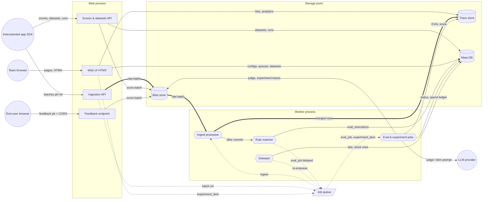

# Traceloom architecture

Status: approved
Approved by: Kunal Mugalkhod
Approved for: 2026-11-09-phase3-evaluation
Change: sdlc/changes/2026-11-09-phase3-evaluation
Updated: 2026-11-09

This document carries forward the accepted Phase 1–2 architecture (repo-root `ARCHITECTURE.md`, ADRs `docs/adr/0001–0012`) and updates it for Phase 3 — Evaluation. New ADRs live in `sdlc/adr/` (0013–0015). **What Phase 3 changes** is summarised at the end of each section under "Phase 3 delta".

## Context
Traceloom is a self-hosted LLM-engineering platform. Teams instrument their LLM apps and agents with the SDK or OTLP, and Traceloom ingests the traces, shows them for debugging, tracks token cost, versions prompts, and runs them in a playground. Phase 3 adds a quality signal on top:
- scores with configs, including end-user 👍/👎 sent with only the public key;
- annotation queues for reviewers;
- LLM-as-a-judge rules that grade live traffic within a daily cost cap;
- datasets and experiments with a run comparison page.

Users are developers, domain-expert reviewers, prompt engineers, admins and (via feedback) the customer's own end users.

## Diagram

The "Eval & experiment jobs" node stands for two handlers on the same eval lane or queue, the Eval job runner and the Experiment runner (see Components). In lite mode the web and worker subgraphs run in one process (`uvicorn traceloom.main:app`), the queue is in-process, the blob store is a local folder and the trace store is SQL in the meta DB. In full mode the worker is its own container (`traceloom worker`), the queue is Redis + Dramatiq, blobs go to S3/MinIO and traces to ClickHouse. Diagram exports: `sdlc/architecture.svg` and `sdlc/architecture.drawio`. No PNG was produced because this machine has neither Playwright nor the Mermaid CLI.

## Components

| Component | Responsibility | Technology | Owns data | Talks to |
|---|---|---|---|---|
| Ingestion API | Validate envelope and key, persist raw batch, enqueue, `207` (unchanged) | FastAPI, `ingest/accept.py` | — | Blob store, Queue, key cache |
| Scores & datasets API | Phase 3 public API: scores CRUD, score configs read, datasets, items, runs, run items (pk+sk) | FastAPI `api/scores.py`, `api/datasets.py` | — (writes via services) | Meta DB; score writes go through `accept_batch` → Blob store |
| Feedback endpoint | pk-only 👍/👎 with per-route CORS and per-key+IP limits (ADR-0015) | FastAPI `api/feedback.py`, own `feedback_key` dependency | — | Key cache, config cache, RateLimiter, `accept_batch` |
| Web UI | Server-rendered pages: traces, prompts, playground, plus score analytics, queues + review, evaluators/rules/log, datasets, experiments, run compare, settings tabs | Jinja2 + HTMX, vendored uPlot, static JS (ADR-0007) | — | Meta DB, Trace store, Queue (experiment start), provider layer (playground) |
| Ingest processor | Merge events, price cost, upsert, refresh aggregates, then call the rule matcher, then move blob to `processed/` | worker handler `ingest/process.py` | traces, observations, scores (via TraceStore) | Blob store, Trace store, Rule matcher |
| Rule matcher | After commit: match cached rules against merged rows, deterministic sample, insert `eval_executions` idempotently, enqueue delayed `eval_job` (ADR-0014) | `evals/rules.py` (in-process in the ingest handler) | `eval_executions` (create) | Cache port, Meta DB, Queue |
| Eval job runner | Claim row, re-check filter, map variables, reserve cap, call provider, validate, write `EVAL` score and judge trace, settle ledger, retry/backoff | `evals/jobs.py`, Phase 2 provider layer (ADR-0011) | `eval_executions` (status), `eval_spend_daily` | Meta DB, Trace store, LLM provider, `accept_batch` |
| Experiment runner | Per dataset item: compile prompt version, call model, record trace in experiment env, store output on run item, create evaluator executions (no delay) | `datasets/experiment.py` | `dataset_run_items` (status, output), `eval_spend_daily` | Meta DB, prompt service, LLM provider, `accept_batch`, Queue |
| Sweeper | Re-enqueue `pending/` blobs (unchanged), due webhook deliveries (lite), and **due or stuck eval/experiment rows (both modes)** (ADR-0013) | `ingest/sweeper.py` thread | — | Blob store, Meta DB, Queue |
| Job queue | Wake-up channel only. Durability lives in blobs and rows | `Queue` port: lite in-process lanes + timer lane; full Dramatiq/Redis, queues `traceloom-ingest` and `traceloom-eval` | — | all handlers |
| Trace store | Traces, observations, scores; aggregates; score filters/sorts; analytics queries | `TraceStore` port: lite SQL / ClickHouse (ADR-0001, 0004) | trace data incl. scores | — |
| Meta DB | Transactional state | SQLAlchemy 2 + Alembic on SQLite/Postgres | users, projects, keys, prompts, connections, webhooks, **score configs, queues, items, eval templates/rules/executions, spend ledger, datasets, items, versions, runs, run items** | — |
| Blob store | Raw batches (SDK, judge, experiment, feedback) | `BlobStore` port: local folder / S3 | `pending/`, `processed/` | — |

Phase 3 delta: new components are Scores & datasets API, Feedback endpoint, Rule matcher, Eval job runner and Experiment runner. The Sweeper and Queue are extended. The new web pages live in the existing Web UI.

## Data

**Stores** are unchanged: the meta DB (SQLite in dev, Postgres otherwise), the trace store (lite SQL or ClickHouse), the blob store and the queue. Phase 3 adds no new store or service.

**New meta-DB tables (migration `0003_evaluation`)**, as specified in spec.md "Data and interfaces", plus these architecture-level additions:

| Table | Written by | Key indexes / constraints | Expected volume (NFR-1 scale) |
|---|---|---|---|
| `score_configs` | Web UI (Admin) | unique `(project_id, name)` where not archived | tens per project |
| `annotation_queues`, `annotation_items` | Web UI | unique `(queue_id, object_type, object_id)`; `(queue_id, status, created_at)` for the claim | ≤ `TRACELOOM_QUEUE_BULK_MAX` per bulk add |
| `eval_templates`, `eval_template_versions` | Web UI; built-ins seeded from `evals/starter.yaml` | `(template_id, version)` unique | tens |
| `eval_rules` | Web UI (Admin) | `(project_id, enabled)` | ≤ ~50 per project |
| `eval_executions` | Rule matcher (create), Eval runner (status), Web UI (retry, backfill) | partial unique `(rule_id, object_type, object_id) WHERE rule_id IS NOT NULL`; `(status, run_after)` for sweeper; `(project_id, created_at)` for the log | up to sampled-traffic rate. **+ `estimated_cost` column** |
| `eval_spend_daily` **(new, ADR-0014)** | Eval runner, Experiment runner | PK `(project_id, day)` | one row per project per day |
| `project_eval_settings` | Web UI (Admin) | PK `project_id` | one per project |
| `datasets`, `dataset_items`, `dataset_item_versions` | Web UI, public API, import | `(dataset_id, status)`; `(item_id, version)` unique | ≤ 10k items per dataset at NFR scale |
| `dataset_runs`, `dataset_run_items` | public API, Experiment runner | unique `(dataset_id, name)`; `(run_id, item_id)`; `(status, run_after)`. **+ `output JSON, latency_ms, cost, estimated_cost` columns** (FR-D5 says the run item holds them) | runs × items, e.g. 4 × 500 |

**Trace store changes.** The `scores` table (lite and ClickHouse) gains `queue_id`, `execution_id`, `channel` and `dataset_run_id`, plus an index on `(project_id, name, timestamp)`. In ClickHouse there is also a `bloom_filter` skip index on `name`. The `source` values become `API|ANNOTATION|EVAL`, and the migration maps existing UI-created rows to `ANNOTATION`.

**Score filters and sorts.** Score filters are `EXISTS`/`NOT EXISTS` subqueries on `scores (project_id, trace_id, name)`, and sorts use a grouped average joined back on `trace_id`.
- They are always bounded by the list's time range, so they ride the existing `(project_id, date, …)` prefix.
- In ClickHouse they read the scores `FINAL` within the same time window.

**Analytics.** `score_distribution`, `score_trend` and `score_pairs` fetch at most 50k values or pairs, sampled above that. The statistics are computed in Python (spec assumption).

**Retention.** Raw blobs, `eval_executions`, `webhook_deliveries` and dataset item versions are all kept indefinitely in Phase 3, and retention and pruning arrive in Phase 4. `dataset_item_versions` is append-only by design.

**Who writes scores:**
- The ingest processor writes API-source scores from batches, which includes public API and feedback scores since those go through `accept_batch`.
- The eval runner writes EVAL scores directly through `TraceStore.add_score`, using the idempotent id from `execution_id`.
- The Web UI writes ANNOTATION scores directly through `TraceStore.add_score`, so reviewers see their score at once.

## Key flows

**1. Ingest → rule match → delayed judge (AC-1)**
1. The SDK posts a batch. The Ingestion API writes the blob to `pending/`, enqueues `{project_id, blob_key}` and returns `207` (unchanged, ADR-0002).
2. The ingest processor merges and upserts the rows into the trace store and refreshes the aggregates.
3. **After commit**, the rule matcher loads the project's enabled rules from the cache, with a TTL of `TRACELOOM_EVAL_RULE_CACHE_SECONDS`. It skips objects in the eval and experiment environments, then tests each rule's target and its row-answerable filter predicates in memory.
4. For each match it computes the sampling hash `sha256(rule_id:object_id)`. If the object is sampled, the matcher runs `INSERT … ON CONFLICT DO NOTHING` into `eval_executions` with `run_after = now + delay`, then `enqueue(eval_job, delay_seconds)`. Errors are logged and swallowed.
5. The blob moves to `processed/`. A crash before this step replays the batch, and step 4 is idempotent.

**2. Judge execution with the cost cap (AC-1–AC-3)**
1. An `eval_job` message wakes the eval lane (lite timer lane, or Dramatiq delay on `traceloom-eval`). The handler claims the row with a conditional `UPDATE`; if no row was updated, the handler exits.
2. It re-checks the full filter against the store with the object id pinned. If the object no longer matches, the row becomes `skipped`.
3. It resolves the variables from input, output, metadata or a child observation through the JSONPath subset. A missing variable fails the job without retry.
4. It estimates the cost and reserves it in `eval_spend_daily` with a conditional `UPDATE`. If the cap would be exceeded, the row becomes `capped` with the reason, and there is no retry.
5. It calls the provider through the Phase 2 adapter with the output schema. It validates the output and prices the usage with `compute_cost`.
6. It writes the `EVAL` score (`id = uuid5(execution_id)`, `comment = reasoning`) through `TraceStore.add_score`. It submits the judge trace (`eval:<template>`, environment `traceloom-eval`) through `accept_batch`.
7. In one transaction it marks the row `succeeded` (with `score_id`, `judge_trace_id`, `cost`) and moves the ledger: `spent += actual`, `reserved -= est`.
8. On a retryable error it sets `pending`, `run_after = now + backoff`, and re-enqueues with the delay. At `TRACELOOM_EVAL_MAX_ATTEMPTS` the row is `failed` with a scrubbed error.

**3. UI experiment (AC-6, AC-7)**
1. A Member submits "New experiment". The web process creates the `dataset_runs` row with `dataset_version = latest change timestamp`, creates one `dataset_run_items` row per active item (pinning `item_version`), enqueues one `experiment_item` per row, and writes an audit row.
2. The experiment runner claims the run item and reserves the cap. It compiles the prompt version with the item input, calls the model, and stores the output, latency and cost on the run item. It submits the trace in `traceloom-experiment` with the run link.
3. For each chosen evaluator it creates an `eval_executions` row with `run_item_id` set and no delay, then enqueues it. Variables bind from the item version (`input`, `expected_output`) and the run item (`output`), so the judge does not wait for the experiment trace to be ingested.
4. When no item of the run is still `pending` or `running`, the run becomes `completed`. The run page polls progress with HTMX.
5. The comparison page reads the run items, then batch-reads their scores by trace id with `score_aggregates`. It computes aggregates, "best" markers and regressions in Python, 100 items per page.

**4. Public feedback (AC-8)**
1. The browser sends a preflight. The route answers with CORS headers only when the origin is in the cached union of all project allowlists.
2. On the `POST`, the `feedback_key` dependency resolves the pk to a `FeedbackPrincipal`. The route checks the per-key and per-IP rate limits, then the origin against this project's list (403 if it is not there), then the config (`public_feedback`, not archived) and the value.
3. It builds a `score-create` event (`source=API`, `channel=public_feedback`, an idempotent id when the client sends one) and calls `accept_batch`, which returns `202`. The ingest processor writes the score.

**Background: the sweeper** runs every sweep interval. It handles pending blobs (unchanged), due webhook deliveries (lite, unchanged), and up to `TRACELOOM_EVAL_SWEEP_BATCH` eval or experiment rows that are due but not picked up, or stuck in `running` past `TRACELOOM_EVAL_STUCK_SECONDS`. Stuck rows are reset and their reservations released.

## Quality attributes

| Target (source) | How the design meets it | Checked by |
|---|---|---|
| Ingestion never blocked or failed by evaluation (NFR-4) | Matching runs after the commit, in a try/except. Judge calls run on a separate lane (lite) or a separate Dramatiq queue and threads (full), never on ingest threads | AC-2 test: an always-failing provider, ingest still `207` and processed |
| Rule matching < 5 ms per trace with 50 rules (NFR-1) | Rules are cached per project. Matching is in-memory predicate evaluation with no DB reads; only a match costs one `INSERT` and one enqueue | Timed unit test with 50 rules |
| List with score filter < 1 s @ 50k traces / 200k scores (NFR-1) | Time-bounded `EXISTS` on the `scores (project_id, trace_id, name)` index, using keyset pagination | Lite perf test at NFR scale |
| Analytics < 2 s (30 days, compare) | A few grouped queries, with pairs capped at 50k and statistics in Python | Timed API test |
| Queue claim < 100 ms, never double-claimed (NFR-1, NFR-2) | One conditional `UPDATE … RETURNING` (Postgres), or a conditional `UPDATE` + rowcount + retry (SQLite), on the `(queue_id, status, created_at)` index | AC-5: 20 concurrent claims |
| Compare 4 runs × 500 items < 1.5 s | Pages of 100 items, with one batch score-aggregate query per page per run | Timed API test |
| Delayed jobs survive restart; experiments resume (FR-X1, NFR-4) | The rows are the source of truth, and the sweeper recovers lost wake-ups and stuck jobs in both modes (ADR-0013) | Contract tests on both queue adapters, plus a restart test |
| Cap never exceeded by more than the estimate error (FR-J6) | Atomic reservation in the ledger before every call, including under concurrency (ADR-0014) | AC-3, plus a concurrent-reservation unit test |
| Exactly one job per (rule, object), no double sampling (FR-J4, NFR-2) | Deterministic hash and a partial unique index | Replayed-batch test |
| Offline tests (NFR-5, AC-14) | `FakeProvider`, lite mode and the socket guard; Dramatiq `StubBroker` for the full queue adapter | Default suite |

## Security
- **Trust zones.** There are four:
  1. The public internet calling the Ingestion, public and feedback APIs.
  2. Signed-in browsers calling the Web UI.
  3. The internal web/worker processes and stores.
  4. Third-party LLM providers. Trace content crosses to them **only** through judge rules and experiments that an Admin or Member configured.
- **AuthN.** Sessions use signed cookies with CSRF protection (ADR-0009, unchanged). Public APIs use pk+sk Basic auth. The feedback route uses its own pk-only `feedback_key` dependency and a distinct principal type that no other route accepts. Every other route answers pk-only auth with 401 (ADR-0015).
- **AuthZ.** All new permissions go into the single matrix in `auth/permissions.py` (spec permissions table):
  - Score configs, judge rules (create, edit, enable, backfill), the cost cap, feedback origins and queue or dataset deletion are Admin+.
  - Enabling a rule shows a confirmation naming the provider and model, and is audited (owner decision).
  - Every service method takes `project_id` first. Every lookup by id filters on `project_id`, including `eval_executions`, run items and queue items.
- **CORS** appears only on `/api/public/feedback`, only for allowlisted origins, and never with credentials. The CSP is unchanged (`script-src 'self'`). `feedback.js` is a static file with no `eval`.
- **Secrets.** Provider keys stay Fernet-encrypted (ADR-0011). Execution and experiment errors pass through the Phase 2 scrubber before they are stored or rendered. Queue messages carry ids only.
- **PII and egress.** Judge prompts send the mapped trace fields to the provider named on the rule, and nowhere else. Judge and experiment traces stay in the same project. Judge reasoning, dataset JSON, CSV cells and comments render escaped (AC-13).
- **Input limits.**
  - CSV is parsed with the stdlib `csv` module, within the upload size limit and `TRACELOOM_DATASET_IMPORT_MAX_ROWS`.
  - JSONPath is a small fixed subset with no evaluation.
  - Feedback comments are at most 1,000 characters.
  - Bulk queue adds are capped by `TRACELOOM_QUEUE_BULK_MAX`, and backfill by `TRACELOOM_EVAL_BACKFILL_MAX`.
- **Rate limits.** Feedback is limited per key and per IP (`TRACELOOM_RATE_FEEDBACK`). The public score and dataset writes use the existing per-key ingest limiter, each with its own scope bucket.

## Configuration
Everything that changes per environment comes from `Settings` (env) or project settings. Existing variables are unchanged: `TRACELOOM_ENV`, `TRACELOOM_MODE`, `DATABASE_URL`, `TRACELOOM_SERVER_SECRET`, `TRACELOOM_BASE_URL`, `TRACELOOM_BLOB_DIR`, `TRACELOOM_INGEST_*`, `TRACELOOM_RATE_AUTH`, `TRACELOOM_RATE_INGEST`, `TRACELOOM_ENCRYPTION_KEY`, `TRACELOOM_LLM_ALLOW_PRIVATE`, `TRACELOOM_WEBHOOK_ALLOW_PRIVATE`, `TRACELOOM_PLAYGROUND_RATE`, `TRACELOOM_PROVIDER_TIMEOUT_SECONDS`, `REDIS_URL`, `S3_*`, `CLICKHOUSE_*` and `SMTP_*`.

New in Phase 3 (all go in `Settings` and `.env.example`):

| Variable | Default | Used by |
|---|---|---|
| `TRACELOOM_RATE_FEEDBACK` | `60/minute` | Feedback endpoint (per key and per IP) |
| `TRACELOOM_QUEUE_BULK_MAX` | 5000 | Add-from-filter |
| `TRACELOOM_ANNOTATION_LOCK_MINUTES` | 10 | Queue claim |
| `TRACELOOM_EVAL_DAILY_COST_CAP_USD` | 10 | Cap default; Admin override in `project_eval_settings` |
| `TRACELOOM_EVAL_MAX_ATTEMPTS` | 3 | Eval and experiment retries |
| `TRACELOOM_EVAL_ENVIRONMENT` | `traceloom-eval` | Judge traces; excluded from matching and default views |
| `TRACELOOM_EXPERIMENT_ENVIRONMENT` | `traceloom-experiment` | Experiment traces |
| `TRACELOOM_EVAL_BACKFILL_MAX` | 1000 | Rule backfill |
| `TRACELOOM_EVAL_CONCURRENCY` | 4 | Lite eval lane threads; full `traceloom-eval` Dramatiq threads |
| `TRACELOOM_DATASET_IMPORT_MAX_ROWS` | 10000 | CSV/JSON import |
| `TRACELOOM_EVAL_RULE_CACHE_SECONDS` | 10 | Rule cache TTL (**architecture addition**; the spec fixed 10 s) |
| `TRACELOOM_EVAL_STUCK_SECONDS` | 600 | Sweeper resets `running` rows older than this (**architecture addition**) |
| `TRACELOOM_EVAL_SWEEP_BATCH` | 500 | Max eval/experiment rows re-enqueued per sweep (**architecture addition**) |
| `FORWARDED_ALLOW_IPS` (uvicorn) | unset | Trust `X-Forwarded-For` only from the proxy, for per-IP feedback limits |

Per-project settings (UI, Admin+) are the cost-cap override and `feedback_origins`.

## Decisions
Carried forward (accepted, in `docs/adr/`):
- [ADR-0001 ClickHouse for trace data (full), SQL for lite](../docs/adr/0001-trace-data-store.md)
- [ADR-0002 Blob-first ingestion with a pending sweeper](../docs/adr/0002-s3-first-ingestion.md)
- [ADR-0003 Dramatiq on Redis for the job queue](../docs/adr/0003-queue-library.md)
- [ADR-0004 Lite mode through storage ports](../docs/adr/0004-storage-ports.md)
- [ADR-0005 Code-evaluator sandbox (Phase 6)](../docs/adr/0005-code-evaluator-sandbox.md)
- [ADR-0006 The AI gateway is a separate process (Phase 5)](../docs/adr/0006-gateway-process.md)
- [ADR-0007 Server-rendered Jinja + HTMX](../docs/adr/0007-frontend.md)
- [ADR-0008 Idempotent, order-independent event merge](../docs/adr/0008-event-merge-semantics.md)
- [ADR-0009 Sessions, password hashing and API-key hashing](../docs/adr/0009-auth-and-keys.md)
- [ADR-0010 Prompt storage and resolution](../docs/adr/0010-prompt-storage-and-resolution.md)
- [ADR-0011 LLM connections and provider adapters](../docs/adr/0011-llm-connections-and-providers.md)
- [ADR-0012 Webhook delivery](../docs/adr/0012-webhook-delivery.md)

New in Phase 3 (proposed, in `sdlc/adr/`):
- [ADR-0013 Delayed and scheduled jobs](adr/0013-delayed-and-scheduled-jobs.md): persisted `run_after` rows, the queue as a wake-up, the sweeper as fallback, a lite timer lane and a full Dramatiq delay on a separate `traceloom-eval` queue
- [ADR-0014 Evaluation execution and the daily cost cap](adr/0014-evaluation-execution-and-cost-cap.md): matching after commit, deterministic sampling, idempotent executions and scores, judge traces via `accept_batch`, and a meta-DB spend ledger with reservations
- [ADR-0015 Public feedback endpoint](adr/0015-public-feedback-endpoint.md): pk-only dependency, `public_feedback` configs only, per-route CORS from the union of allowlists plus a per-project origin check, per-key and per-IP limits, and the write through `accept_batch`

## Open questions
- [x] **Should traces in `traceloom-experiment` trigger online judge rules?** (a) Never. Online rules ignore both `traceloom-eval` and `traceloom-experiment` traces; experiments run only their chosen evaluators. — decided by Kunal Mugalkhod (2026-11-09)
- [x] **What does the cap do for a model with no price definition?** (a) Allow it, and warn on the rule editor, the experiment form, the execution log and the Evaluation settings tab: "unpriced model, the cost cap does not apply". — decided by Kunal Mugalkhod (2026-11-09)

## Out of scope
- Retention and pruning of blobs, `eval_executions`, deliveries and item versions (Phase 4).
- Custom dashboards, the AI gateway (ADR-0006), the JS/TS SDK, exports (Phase 4+).
- A separate Compose service for evaluation workers. The `traceloom-eval` queue runs inside the existing worker until load says otherwise (ADR-0013 "Revisit when").
- Cron-style scheduled jobs. The ADR-0013 mechanism is delay-based only.
- Code evaluators (ADR-0005, Phase 6), multi-modal judges, prompt auto-optimisation.
- Signed per-trace feedback tokens (rejected by the owner; the ADR-0015 revisit path).
